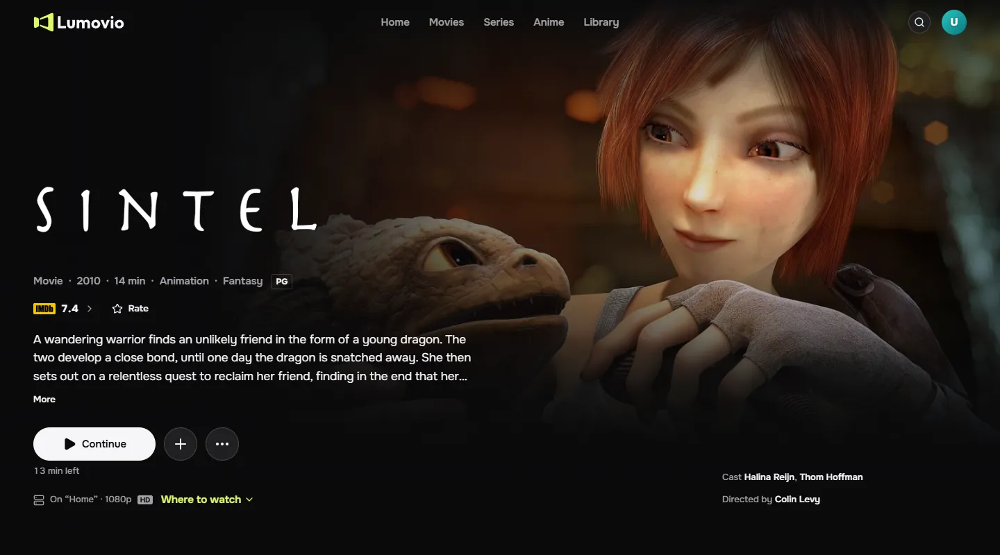
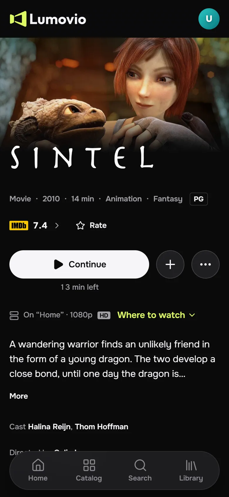
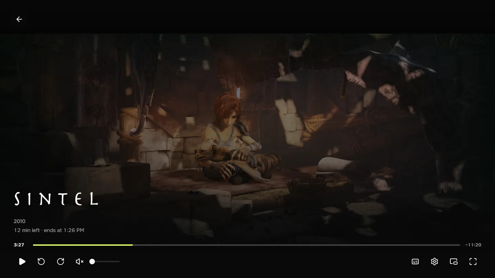
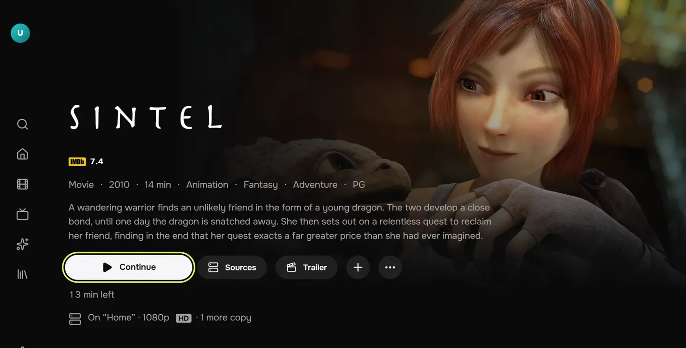

<p align="center">
  <a href="https://lumovio.app">
    <picture>
      <source media="(prefers-color-scheme: dark)" srcset="apps/web/public/brand/logo-dark.svg">
      
    </picture>
  </a>
</p>

<p align="center">
  Films, series and anime: one watch history, watchlists and lists on every device,<br>
  and your own Jellyfin, Plex or TorrServer in the built-in player — on a phone, a computer or a TV.
</p>

<p align="center">
  <a href="https://lumovio.app"></a>
  <a href="https://github.com/MOJI6416/lumovio-web/actions/workflows/ci.yml"></a>
  <a href="https://github.com/MOJI6416/lumovio-web/releases/latest"></a>
  <a href="LICENSE"></a>
</p>

<p align="center">
  
  
</p>
<p align="center">
  
  
</p>
<p align="center"><sub>A title page on a computer and a phone, the player, and the TV interface. The film is
<a href="https://durian.blender.org/">Sintel</a>, © Blender Foundation, CC BY 3.0.</sub></p>

## What Lumovio does

- **A catalog in ten languages** — films, series and anime with ratings from IMDb and others, search that forgives
  typos, shelves that say why a title is there, and picks from each profile's own taste.
- **One library** — watchlist, favourites, ratings, lists (also lists that fill themselves by conditions), history and
  progress, a calendar of new episodes and stats; profiles with kids profiles and PINs.
- **Your own servers** — Jellyfin, Plex and TorrServer, contacted by the browser itself, never through Lumovio.
- **A player that plays what browsers usually can't** — MKV and AVI, AC-3, DTS and TrueHD audio, embedded subtitles
  including ASS, or the file handed to VLC, Infuse or MX Player.
- **A TV interface** for remotes, sign-in by a QR code from a phone, the phone as a remote, and an Android TV app.
- **Imports and sync** — Letterboxd, IMDb, Trakt, Simkl and other exports; Trakt and Simkl accounts kept in sync.

## This repository

- **the web app** (`apps/web`; Next.js 16, React 19, Tailwind CSS 4): the site, its player and the TV interface;
- **the Android TV app** (`apps/tv-android`), a thin WebView shell that opens the site on Android TV and Google TV;
- **the build of the player's WebAssembly decoders** (`scripts/player-codecs`; FFmpeg, LGPL);
- **the API contracts** (`packages/contracts`) shared with the backend.

The Lumovio backend is a separate, private service. For development, a **mock API** is included, so you can run the
whole interface without credentials or keys.

## Quick start

Requirements: Node.js 24+ and pnpm 11 (`corepack enable`).

```bash
pnpm install
cp apps/web/.env.example apps/web/.env.local
pnpm mock      # mock API on http://localhost:4000
pnpm dev       # web app on http://localhost:3000 (second terminal)
```

Sign up with **any** email and password. The mock keeps everything in memory and resets on restart. Its catalog is
synthetic: generated titles and people without artwork, plus four Creative Commons films from the Blender Foundation.

The mock covers the catalog (home, sections, search, title and person pages), sign-in, profiles (including the
kids-profile lock), watchlist, favorites, ratings, lists, progress, history, calendar, stats, devices and media-server
connections. Endpoints that need the real backend (imports, AI search, recommendations, integrations, support, sharing
invites) answer `501 not_configured`, and the interface shows its normal error state for them.

### The TV interface

Open `http://localhost:3000/tv`: it turns TV mode on in this browser, and every address then answers with the TV
interface (`src/app/[locale]/tvui`). Use the arrow keys, Enter and Escape (Back) as a remote. A TV is recognised by its
user agent and gets this interface on its own.

### Connecting a real media server

Media servers are contacted **directly by the browser**, never through Lumovio's servers. The mock stores connections
the way the real API does, so you can develop against your own Jellyfin, Plex or TorrServer from **Settings → Servers**,
and play your own files in the player. The server must allow CORS from `http://localhost:3000`. For password-protected
TorrServer streams, the service worker (`public/sw.js`) adds the credentials.

## Project layout

```
apps/web/
  src/app/[locale]/       routes (App Router); `[locale]/layout.tsx` is the root layout
  src/app/[locale]/tvui/  the TV interface
  src/components/         UI by feature: player, title, library, connections, tvui, …
  src/lib/media/          codec detection, in-browser remux, Jellyfin / Plex / TorrServer clients
  src/i18n/               locales and routing (next-intl)
  messages/               translations, one JSON file per locale
  public/codecs/          the player's WebAssembly decoders (built by scripts/player-codecs)
  public/sw.js            service worker: offline shell + TorrServer auth bridge
  mock/                   the mock API (plain Node, no dependencies)
apps/tv-android/          the Android TV app (Kotlin, one WebView)
packages/contracts/       zod schemas and TypeScript types shared with the API
scripts/player-codecs/    how public/codecs is built from FFmpeg and JASSUB
```

Things that differ from older Next.js versions: `src/proxy.ts` replaces middleware, route params are async, and the
locale comes from `next/root-params`. The bundled docs live in `node_modules/next/dist/docs/`.

## Playback in a nutshell

`src/lib/media/capabilities.ts` asks the browser what it can actually decode (`MediaSource.isTypeSupported` /
`canPlayType`, never the user agent). Each file then plays directly, is remuxed in the browser (MKV and AVI into
MediaSource with Mediabunny; audio the browser can't decode, such as AC-3, DTS or TrueHD, decoded by Mediabunny and by
FFmpeg in WebAssembly), is remuxed or transcoded by the server (Jellyfin HLS, Plex), or opens in an external player
such as VLC, Infuse or MX Player. The player is Video.js 10 with hls.js; embedded ASS subtitles are drawn by JASSUB.

## The Android TV app

`apps/tv-android` is the app TVs install: the site in a WebView, with the remote's Back and media keys, video in full
screen and its own update offer. See its [README](apps/tv-android/README.md) to build it. Every version Lumovio
publishes is in this repository's [Releases](https://github.com/MOJI6416/lumovio-web/releases), the same signed APK
that `lumovio.app/apk` serves.

## Checks

```bash
pnpm typecheck
pnpm test        # vitest: codec decisions, torrent helpers, routing, slugs
pnpm build
```

## Translations

UI strings live in `apps/web/messages/<locale>.json`, in ten languages: English, Ukrainian, Russian, German, Spanish,
French, Brazilian Portuguese, Italian, Polish and Turkish. Fixes from native speakers are very welcome. Keep the keys
identical to `en.json`.

## How this repository is made

Lumovio is developed in a private monorepo with its backend. This repository is exported from it on every change, as
one commit (`.lumovio-export` names the source commit); pull requests are reviewed here and applied there, and the next
export brings them back. See [CONTRIBUTING](CONTRIBUTING.md), and [SECURITY](.github/SECURITY.md) for reporting a
vulnerability.

## Data and attribution

Catalog data in the real service comes from [TMDB](https://www.themoviedb.org/). This product uses the TMDB API but is
not endorsed or certified by TMDB. The mock API ships no TMDB data. The Blender Foundation films are © Blender
Foundation, licensed CC BY. The logos in `apps/web/public/brands/` (IMDb, Rotten Tomatoes, Metacritic, TMDB, AniList,
TVmaze, Letterboxd, Kinopoisk, MyAnimeList, Wikidata) are trademarks of their owners, used only to name the source of a
score or link, and are **not** covered by the Apache license. The player's decoders are built from FFmpeg
(LGPL-2.1-or-later, `scripts/player-codecs`) and JASSUB (MIT, with LGPL parts,
`apps/web/public/codecs/jassub/LICENSE.txt`); the site's Acknowledgements page names them.

## License

Apache License 2.0, see [LICENSE](LICENSE). The Lumovio name and logo (`brand/`, `public/brand/`, `src/lib/brand.ts`,
the generated app icons and the Android TV app's launcher and splash images) are not covered by the license; please
don't use them for forks in a way that suggests an official build.
